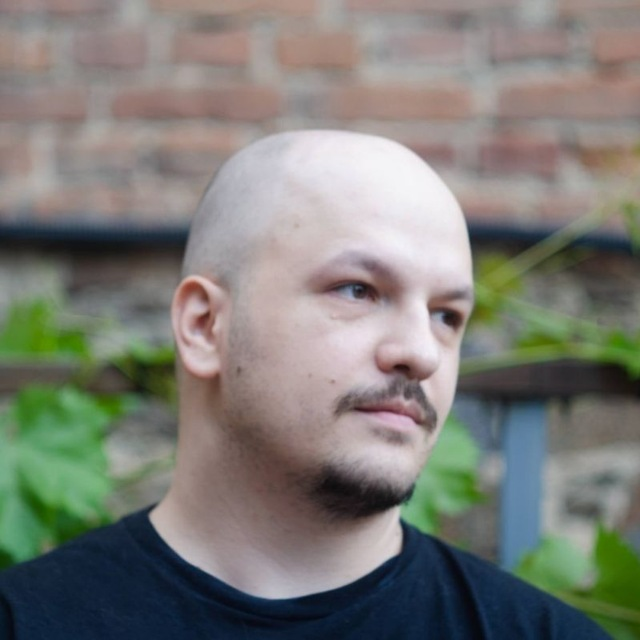
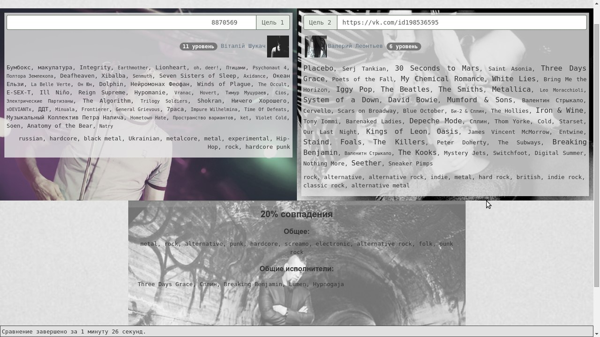
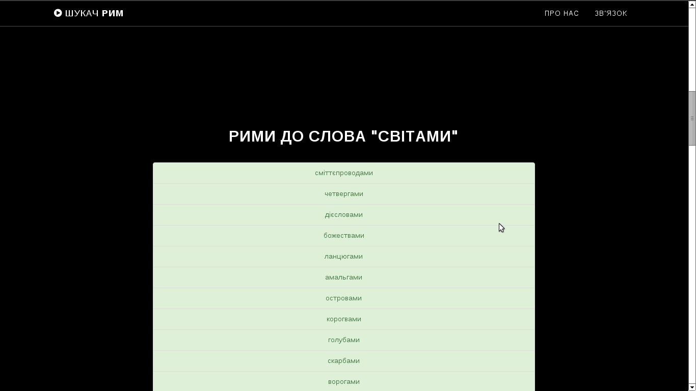

## The person behind the terminal

My name is Vitalii Perehonchuk. I'm a Lead Software Engineer from Vinnytsia, Ukraine, focused on full-stack web development with React and Node.js.

I also contribute to Ukrainian developer documentation and build tools for exploring family history and music.

[GitHub](https://github.com/undead404) · [Threads](https://www.threads.com/@brute18)

My main interests are:

- full-stack web development with React and Node.js
- music and drumming
- tabletop role-playing games — for example, Kavaleriia (sci-fi, neofeudalism, mecha) by M87\* Games
- genealogy — I blog mostly about it on [Threads (@brute18)](https://www.threads.com/@brute18)

## Current projects {#current-projects}

### Корені

[koreni.org.ua](https://koreni.org.ua/)

I created Корені, a search engine for genealogical indexes, bringing together data from many separate tables to help people find their roots.

[About the project](https://koreni.org.ua/about/) · [Source code](https://github.com/undead404/koreni) · [Project updates](https://t.me/koreni_org_ua)

I also contribute archival indexes myself. As of November 2026, my [volunteer profile](https://koreni.org.ua/volunteers/vitalii-perehonchuk/) credits me with 122,900 records across 104 tables. My research includes parish registers, confession lists, and revision lists from places such as Політанки, Писарівка, and Черепашинці.

### Генеалогія Шаргородщини

[sharhoroots.koreni.org.ua](https://sharhoroots.koreni.org.ua/)

A knowledge base for researching family history and locating parish registers and archival records from the historical Sharhorod, Dzhuryn, and Murafa areas.

### ЇХ Подкаст

[Listen to the podcast](https://podtail.com/en/podcast/cddf8d0f/)

Олександр Товмач, the developer of Качиний Інспектор, and I discuss genealogy, our research experiences, the Ukrainian genealogy community, and the software we build. Topics include why we research our family histories, gaps in the records, and the role of individuals in history.

### Пісня туманів

[Knowledge base](https://undead404.github.io/pisnia-tumaniv/) · [YouTube playlist](https://www.youtube.com/playlist?list=PL2zoJ5Mco28pMShErqXngbEWYwr65IDCb)

A knowledge base for Пісня туманів, a campaign I play in using the indie tabletop role-playing game **Кавалерія** by Ukrainian publisher [**M87\* Games**](https://m87games.com/).

Our game master is [Oleksandr Trifan (Олександр Тріфан)](https://linktr.ee/alexander_trifan), the creator of Кавалерія and founder of M87\* Games.

### Eclipse Phase Second Edition українською

[Rulebook](https://undead404.github.io/eclipsephase-uk/)

Ukrainian translation of a post-apocalyptic sci-fi horror TTRPG – Eclipse Phase Second Edition.
_Unfinished yet._

### You Must Hear 8

[ymh8.pages.dev](https://ymh8.pages.dev/)

A music discovery project for exploring releases, genres, and rankings.

## Music {#music}

Once I was a drummer:

- [ellan](https://ellanband.bandcamp.com) (post-rock with violin) — active around 2015–2017.
- [Necrophag](https://www.youtube.com/@necrophag7942) (blackened speed metal) – around 2017–2021.

I also used to write about extreme metal on my Telegram channel, [Непізнаний простір](https://t.me/vast_space_unexplored), and on Twitter as [@negativo_ua](https://x.com/negativo_ua).

My Twitter threads about extreme metal from 2022 are easy to find on [Typefully](https://typefully.com/negativo_ua).

## Work experience {#work-experience}

### EPAM

_2020–present_

I'm currently a Lead Software Engineer. My main focus is full-stack development with React and Node.js.

### ElifTech

_2017–2020_

My first software engineering job, where I grew from trainee to middle developer and mentored frontend students at ElifTech IT School.

## Education

**Bachelor's degree in Software Engineering**, Vinnytsia National Technical University (ВНТУ), 2013–2017.

## Open-source contributions {#open-source-contributions}

### WebDoky

[webdoky.org](https://webdoky.org/) · [Content repository](https://github.com/webdoky/content)

I contributed to WebDoky, a project making MDN web documentation available in Ukrainian. I also [helped invite new translators](https://discourse.mozilla.org/t/ukrainian-translations-are-gone-from-mdn/79939?page=2) to the project.

### Ukrainian React documentation

[uk.react.dev](https://uk.react.dev/) · [Translation contributions](https://github.com/reactjs/uk.react.dev/issues/457)

I contributed Ukrainian translations of “Start a New React Project” and “Editor Setup,” along with work on navigation and sidebar titles.

## Past projects {#past-projects}

_Kept here for nostalgia._

### Drukarnia blog

_2024_

In 2024, I maintained a [blog on Drukarnia](https://drukarnia.com.ua/negativo_ua), publishing translations and my own writing on a variety of topics.

### socmusrec

_JavaScript, AngularJS, Last.fm API, Azure_

`socmusrec` was a fully frontend project for analyzing personal music libraries with the Last.fm API and comparing two users' tastes in music - **in percents**. Asynchronous work was handled with promises. I remember it fondly as an early experiment in music analysis.

All the code was written in JavaScript by means of AngularJS, the site was launched at Azure.

The project was also described in a [VNTU conference publication](https://conferences.vntu.edu.ua/public/files/1/fitki_2016_netpub.pdf), covering music taste comparison using Last.fm data.

### rhymes-seeker

_PHP, MySQL_

`rhymes-seeker` was built ontop of an **enormous MySQL database of Ukrainian language**: all the words, about 1,000,000 forms of words.

A user provided a word, and `rhymes-seeker` answered with possible rhymes. Words were handled by their pronunciation.

`rhymes-seeker` was never launched due to bulkiness of its database, and now the database is lost.

The Ukrainian title was **Шукач рим**. I co-authored the program, whose sound- and stress-based rhyme search is documented in the [2015 official copyright bulletin](https://ukrpatent.org/atachs/AvtorPravo_%E2%84%9636_2015.pdf).

### adir114.info

adir114.info was my first real project, I've developed it when I was about 18. It was a frameworkless PHP web site with blog, uploading photos and other files, et cetera. An MLM organization used it as its home page.

It's dead since 2014, but you can look how awful it was via Wayback Machine.
