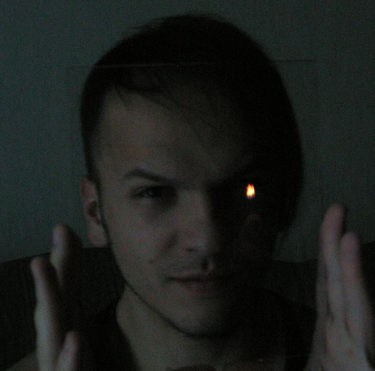
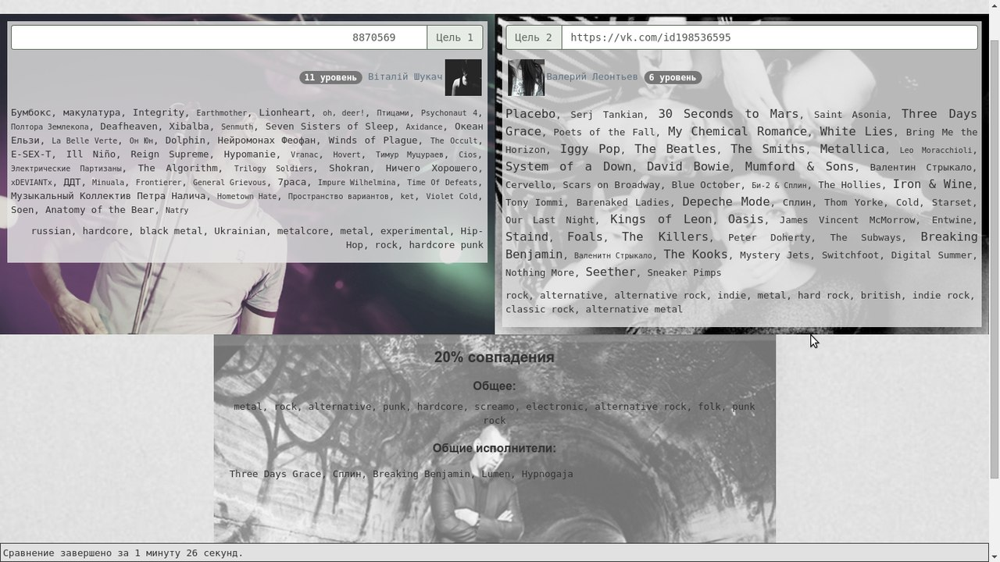
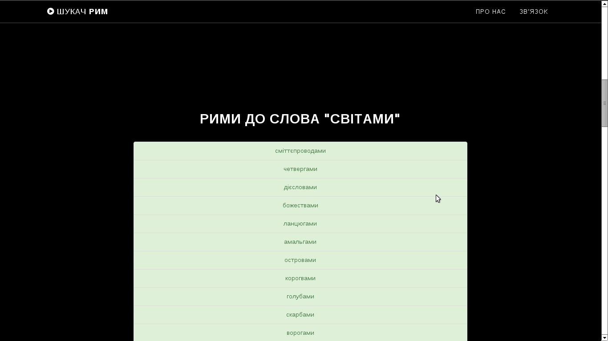

# Welcome to my world

My name is Vitalii Perehonchuk. I'm a Lead Software Engineer from Vinnytsia, Ukraine, focused on full-stack web development with React and Node.js.

My main interests are:
- full-stack web development with React and Node.js
- science fiction - movies, books
- music - playing drums, listen to my band: [ellan](https://ellanband.bandcamp.com)

## Work experience

### EPAM
_2020–present_

I'm currently a Lead Software Engineer. My main focus is full-stack development with React and Node.js.

### ElifTech
_2017–2020_

My first software engineering job, where I grew from trainee to middle developer and mentored frontend students at ElifTech IT School.

## Current projects

### Корені
[koreni.org.ua](https://koreni.org.ua/)

A search engine for genealogical indexes, bringing together data from many separate tables to help people find their roots.

### Генеалогія Шаргородщини
[sharhoroots.koreni.org.ua](https://sharhoroots.koreni.org.ua/)

A knowledge base for researching family history and locating parish registers and archival records from the historical Sharhorod, Dzhuryn, and Murafa areas.

### Пісня туманів
[Project website](https://undead404.github.io/pisnia-tumaniv/) · [YouTube playlist](https://www.youtube.com/playlist?list=PL2zoJ5Mco28pMShErqXngbEWYwr65IDCb)

### You Must Hear 8
[ymh8.pages.dev](https://ymh8.pages.dev/)

A music discovery project for exploring releases, genres, and rankings.

## Past projects
_Kept here for nostalgia._

### socmusrec
_JavaScript, AngularJS, Last.fm API, Azure_

`socmusrec` was a fully frontend project for analyzing personal music libraries with the Last.fm API and comparing two users' tastes in music - **in percents**. Asynchronous work was handled with promises. I remember it fondly as an early experiment in music analysis.

All the code was written in JavaScript by means of AngularJS, the site was launched at Azure.

### rhymes-seeker
_PHP, MySQL_

`rhymes-seeker` was built ontop of an **enormous MySQL database of Ukrainian language**: all the words, about 1,000,000 forms of words.

A user provided a word, and `rhymes-seeker` answered with possible rhymes. Words were handled by their pronunciation.

`rhymes-seeker` was never launched due to bulkiness of its database, and now the database is lost.

### adir114.info
adir114.info was my first real project, I've developed it when I was about 18. It was a frameworkless PHP web site with blog, uploading photos and other files, et cetera. An MLM organization used it as its home page.

It's dead since 2014, but you can look how awful it was via Wayback Machine.
